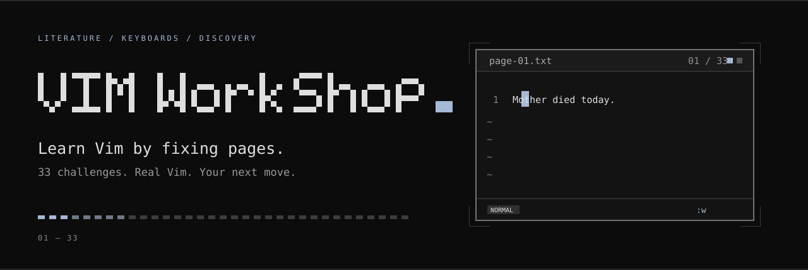
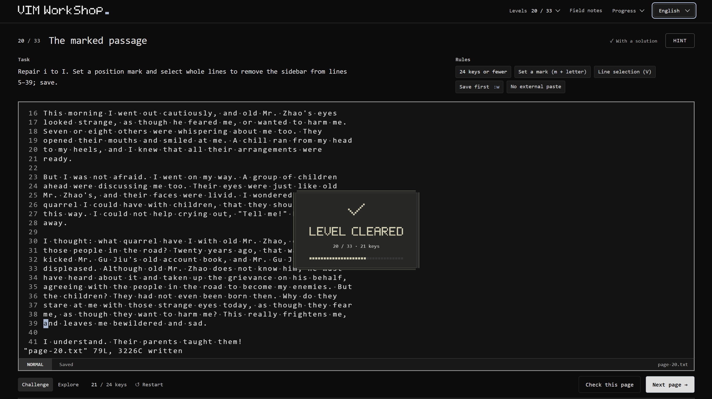
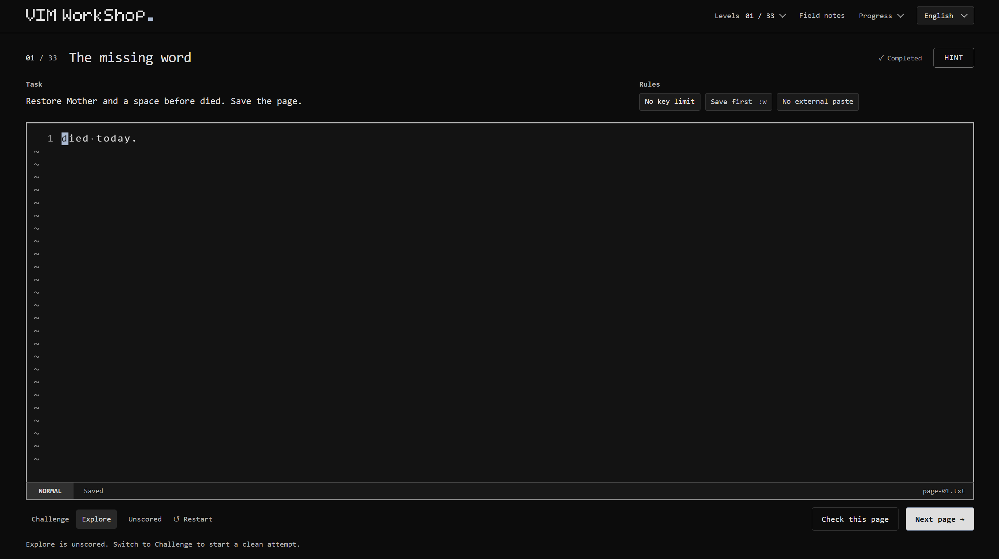

<p align="center">
  
</p>

<h1 align="center">VIM WorkShop</h1>

<p align="center">
  <strong>在真实的 Vim 里，修好一页文字。</strong><br>
  33 道关卡，以文学与歌词为材料，在编辑中学会编辑。
</p>

<p align="center">
  <a href="https://dideass.github.io/vim-workshop/"><strong>进入工坊 ↗</strong></a>
  &nbsp; · &nbsp; <a href="README.md">English</a> / <strong>简体中文</strong>
  &nbsp; · &nbsp; <a href="docs/DEVELOPMENT.md">开发与部署</a>
</p>

<p align="center">
  <a href="https://github.com/Dideass/vim-workshop/actions/workflows/pages.yml"></a>
  <a href="package.json"></a>
  <a href="package.json">=22.12"></a>
  <a href="LICENSE"></a>
  <a href="THIRD_PARTY_NOTICES.md"></a>
</p>

<br>

<a href="https://dideass.github.io/vim-workshop/">
  
</a>

## 先有问题，再找工具

你会拿到一段损坏的文字、一个目标和几条规则，然后自己找到修复的方法。
受 [Bandit](https://overthewire.org/wargames/bandit/) 启发，这里先给你使用命令的理由，让你带着问题查资料、做尝试。

- **真实的 Vim。** 移动、文本对象、寄存器、宏和 `:help`，都在编译为 WebAssembly 的 Vim 中运行。
- **逐渐展开的挑战。** 从补一个词开始，进入选区、分屏与数百行文本的编辑。最后十关更进一步，博尔赫斯留在终章。
- **自己找到路径。** 规则与按键预算公开，符合要求的其他解法同样有效；提示只提供一种走法。
- **放心试错。** 自由探索、干净重试，或逐级打开三层提示。不计时，没有生命值；修好这一页，就收到一枚像素通关印章。

**25 段文学文本 · 8 段歌词间奏 · 中英双语界面**  
待编辑的正文始终为英文，作者、版本与出处收录在「文本出处」中。

<details>
<summary><strong>01 / 从一个缺失的词开始</strong></summary>
<br>

</details>

<br>

## 打开这一页

[**在浏览器中开始 →**](https://dideass.github.io/vim-workshop/) · 请使用桌面浏览器与实体键盘。

无需账号或安装。进度保存在当前浏览器，也可以导出 JSON 备份，带到另一台设备。

本地运行需 Node.js 24：

```sh
npm ci
npm run dev
```

[开发与部署（English）](docs/DEVELOPMENT.md) · [课程与出处](docs/COURSE.md) · [验证记录](VERIFICATION.md)

---

<sub>应用代码采用 <a href="LICENSE">MIT</a> 许可。文学选段与运行时资源分别保留其相应权利，详见<a href="THIRD_PARTY_NOTICES.md">来源与许可说明</a>。</sub>
