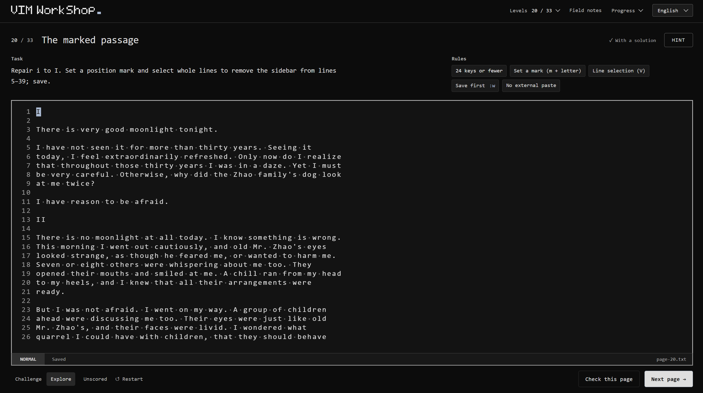

<p align="center">
  
</p>

<h1 align="center">VIM WorkShop</h1>

<p align="center">
  <strong>把 Vim 用起来。</strong><br>
  33 关 Vim 编辑挑战，取材于文学与歌词。
</p>

<p align="center">
  <a href="https://dideass.github.io/vim-workshop/"><strong>开始挑战</strong></a>
  &nbsp; · &nbsp; <a href="README.md">English</a> / <strong>简体中文</strong>
  &nbsp; · &nbsp; <a href="docs/DEVELOPMENT.md">开发与部署</a>
</p>

<p align="center">
  <a href="https://github.com/Dideass/vim-workshop/actions/workflows/pages.yml"></a>
  <a href="package.json"></a>
  <a href="package.json">=22.12"></a>
  <a href="LICENSE"></a>
  <a href="THIRD_PARTY_NOTICES.md"></a>
</p>

<br>

<a href="https://dideass.github.io/vim-workshop/">
  
</a>

## 带着问题学 Vim

VIM WorkShop 借鉴了 [Bandit](https://overthewire.org/wargames/bandit/) 的闯关方式：每关给你一段需要修改的文字，以及明确的目标和规则。你可以先动手尝试，遇到困难再查资料、看提示，找到合适的 Vim 操作。

- **真正的 Vim。** 光标移动、文本对象、寄存器和宏，都由编译为 WebAssembly 的 Vim 执行。
- **从入门到进阶。** 从补回一个词开始，逐步练习选区、分屏和数百行文本的编辑。
- **解法由你探索。** 每关公开操作规则和按键上限。符合要求的解法都能通过，提示只提供其中一种。
- **放心尝试。** 可以自由练习、重新开始，也可以逐级查看三层提示。不计时，不设生命值。

**25 段文学选文 · 8 段歌词 · 中英双语界面**  
编辑材料始终为英文。作者、版本和来源可在每关的「文本出处」（Behind the text）中查看。

## 开始使用

[**在线体验**](https://dideass.github.io/vim-workshop/) · 桌面浏览器 + 实体键盘。

无需注册或安装。进度保存在浏览器中，下次打开可以继续；也支持导出、导入 JSON 备份，方便更换设备。

如需本地运行，推荐使用 Node.js 24：

```sh
npm ci
npm run dev
```

[开发与部署（英文）](docs/DEVELOPMENT.md) · [关卡与文本来源](docs/COURSE.md) · [测试记录](VERIFICATION.md)

---

<sub>项目代码采用 <a href="LICENSE">MIT</a> 许可证。文学、歌词及第三方运行组件的版权与许可另见<a href="THIRD_PARTY_NOTICES.md">相关说明</a>。</sub>
